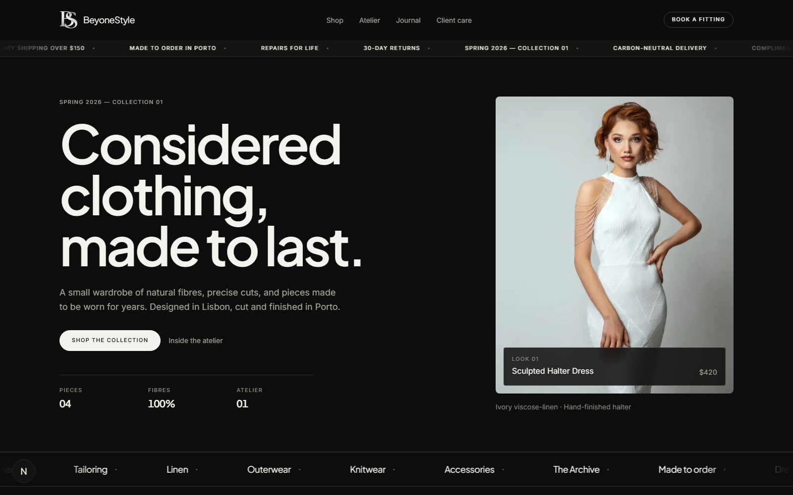
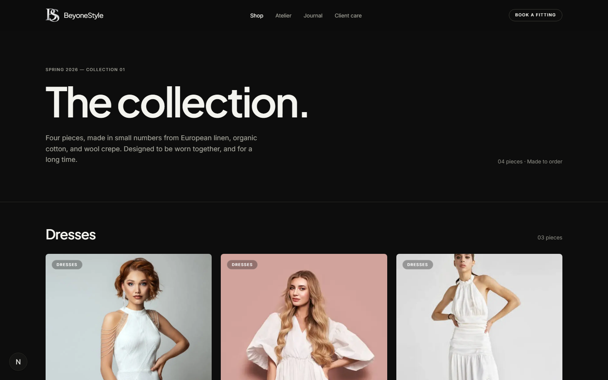
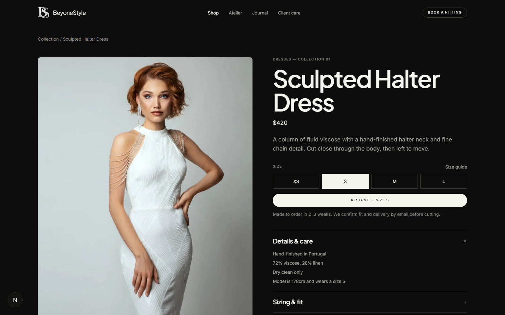
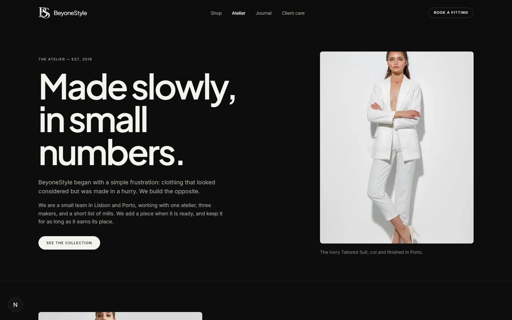
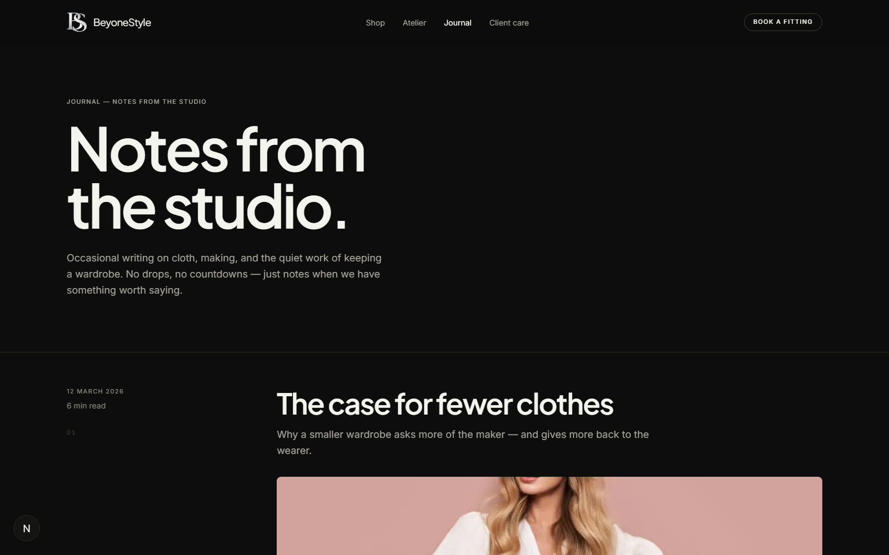
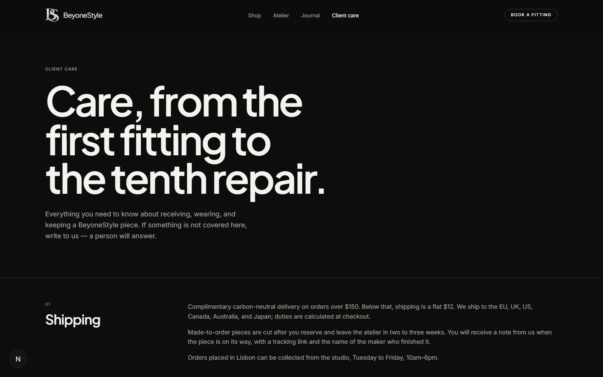
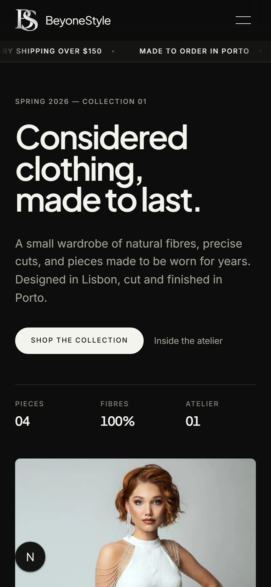

<div align="center">


# BeyoneStyle

**A dark, editorial storefront for a made-to-order clothing atelier.**

<p>
  
  
  
  
  
</p>

</div>



## What this is

BeyoneStyle is a fictional atelier in Lisbon and Porto that cuts a small wardrobe
of natural fibres in runs of forty. This repository is its storefront: a complete,
statically generated Next.js App Router site with an editorial homepage, a
collection, four product pages, an atelier story, a journal, client care, and
legal pages.

Everything on the site is real copy and real interaction — except the back office.
There is no cart, no payment, and no account system. A piece is **reserved by
email**, with the size carried into the message, because that is what a
made-to-order studio actually does.

## The details worth noticing

**Per-letter scramble.** Hover a character in the hero headline and only that
character scrambles, then resolves. The original glyph keeps its width while the
replacement overlays it, so the line never reflows. A screen-reader copy of the
headline is rendered separately, and the effect is disabled under
`prefers-reduced-motion`.

**A marquee that never stops.** The announcement strip keeps moving on hover,
fades at both edges, and brightens the item under the cursor. Only `color` is
transitioned; the glow is applied in a single paint, which removed ~27 layouts
per hover.

**Scroll reveals that cannot strand content.** An `IntersectionObserver` plus a
`MutationObserver` handle the App Router's persistent layout, above-the-fold
content is revealed synchronously, and a `@media (scripting: enabled)` guard
means visitors without JavaScript see everything.

**A type system, not a font choice.** Plus Jakarta Sans for display, Inter for
text, tabular numerals for prices and stats, and a fixed scale from
`text-display-xl` down to `text-eyebrow`.

**Photography that survives a retina tablet.** The four supplied photos were
low-resolution stock previews. They were restored with a local Swin2SR
super-resolution pass, finished at 1600px, and served through `next/image` with
explicit `sizes` so the browser never stretches a small file into a large slot.

## Pages

| Route | What it does |
| --- | --- |
| `/` | Long editorial homepage: hero, category strip, collection, atelier principles, lookbook, process, journal, fitting CTA |
| `/shop` | Collection grouped by category, with hover states and a live piece count |
| `/shop/[slug]` | Four statically generated product pages: gallery, size selection, reservation, accordions, related pieces |
| `/about` | The atelier story, lookbook, and how a piece is made |
| `/journal` | Studio notes with a lead story and an index |
| `/care` | Shipping, returns, size guide, repairs, and contact |
| `/privacy`, `/terms` | Plain-language legal pages |
| `not-found` | Branded 404 |

## Screens

### The collection



### A piece



### The atelier



### The journal



### Client care



### On a phone

<p align="center">
  
</p>

## Design tokens

| Token | Value | Used for |
| --- | --- | --- |
| `--color-surface` | `#0d0d0d` | Page background |
| `--color-surface-muted` | `#141413` | Header, footer, cards |
| `--color-surface-sunken` | `#1b1b19` | Inset panels |
| `--color-ink` | `#f4f4ef` | Primary text |
| `--color-ink-muted` | `#a6a69c` | Body copy |
| `--color-ink-subtle` | `#8a8a82` | Labels, metadata |
| `--color-border` | `#2a2a25` | Hairlines |
| `--color-border-strong` | `#3d3d36` | Controls, dividers |

Motion is limited to three durations (150 / 250 / 400ms) and two easing curves,
both defined in `app/globals.css` so every component moves the same way.

## Stack

- **Next.js 16** App Router, static generation, Turbopack
- **React 19** with server components by default
- **Tailwind CSS 4** with a `@theme` token layer
- **TypeScript** in strict mode, no `any`
- **Vitest 5** + Testing Library + jsdom for component and contract tests

No UI kit, no animation library, no state manager. The scramble, marquee, reveals,
and accordions are small purpose-built components.

## Run it locally

Requires Node.js 20.9 or newer.

```bash
npm install
npm run dev
```

Then open <http://localhost:3000>. To view it from a phone or tablet on the same
network, open the `Network` URL that Next prints and add that host to
`allowedDevOrigins` in `next.config.ts`.

## Checks

```bash
npm test          # 67 tests across 10 files
npm run typecheck # tsc --noEmit
npm run lint      # eslint
npm run build     # fully static build of every page
```

## Project structure

```text
app/
  layout.tsx        Header, footer, reveal observer, back-to-top
  page.tsx          Editorial homepage
  shop/             Collection and static product pages
  about/ journal/ care/ privacy/ terms/
  globals.css       Tokens, type scale, motion primitives
components/
  site/             Header, footer, brand mark, product card, reservation
  ui/               Scramble, marquee, reveal, back-to-top
lib/                Product catalogue and helpers
img/                Source photography and monogram
tests/              Component and contract tests
docs/screenshots/   Images used in this README
```

## Status

The storefront front end is complete. Cart, authentication, database, payments,
filters, and the admin dashboard are future phases, tracked in
[`beyonestyle_development_roadmap_to_do_list.md`](beyonestyle_development_roadmap_to_do_list.md).

The photography is AI-restored from low-resolution previews; a licensed
high-resolution shoot is the intended replacement. The journal entries are
written for the demo and are not linked to full articles.
